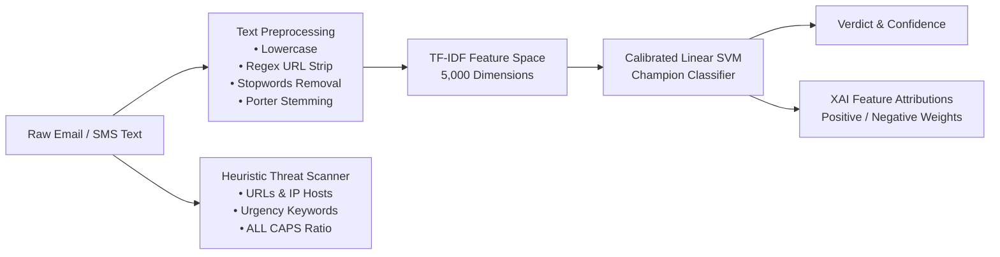

# 🛡️ PhishShieldAI: Intelligent Phishing Email Detection Framework

[](https://www.python.org/)
[](https://streamlit.io/)
[-green.svg)]()
[]()

> **Research Paper Title:**  
> **"PHISHSHIELDAI: A MACHINE LEARNING FRAMEWORK FOR INTELLIGENT PHISHING EMAIL DETECTION USING NATURAL LANGUAGE PROCESSING"**  
> *Authors:* Surendra Shetty, Ashika Poojary, Raksha Shetty  
> *Affiliation:* Department of Master of Computer Applications, NMAM Institute of Technology (NMAMIT), Nitte (Deemed to be University), Nitte, India.

---

## 📌 Project Overview

**PhishShieldAI** is an intelligent, lightweight cybersecurity framework designed to detect phishing and deceptive social engineering attacks in real time. Combining Natural Language Processing (NLP) text preprocessing, TF-IDF feature weighting, and margin-maximizing supervised learning, PhishShieldAI delivers fast, interpretable, and high-precision threat classification.

Unlike computationally heavy deep-learning pipelines (BERT/RCNNs) that introduce latency overhead, PhishShieldAI proves that a well-calibrated **Linear Support Vector Machine (Linear SVM)** achieves **98.48% accuracy** and a **94.04% F1-score** on phishing messages, making it ideal for client-side and real-time email gateway deployment.

---

## 🚀 Key Features

* **Head-to-Head 5-Classifier Benchmark:** Evaluates Probabilistic (Naive Bayes), Linear (Logistic Regression), Tree-based (Decision Tree), Ensemble (Random Forest), and Maximum-Margin (Linear SVM) algorithms.
* **Calibrated Confidence Scoring:** Integrates Platt-calibrated probability estimation for the Linear SVM champion model.
* **Interactive Model Switcher:** Live toggle in Streamlit to compare the champion Linear SVM against Random Forest.
* **Explainable AI (XAI) Word Attribution:** Directly exposes the learned TF-IDF feature weights, highlighting the exact words driving the phishing alarm.
* **Multi-View Heuristic Threat Analysis:** Detects psychological urgency markers, embedded URL links, IP-based destination addresses, and capitalization stress ratios.
* **Live Demo Helpers:** One-click sample loading for seamless academic presentations and evaluations.

---

## 📊 Empirical Benchmark Results (Table II from Paper)

Evaluated on an 80:20 stratified split across 5,572 labelled messages:

| Classifier Family | Model | Accuracy (%) | Precision (%) | Recall (%) | F1-Score (%) |
| :--- | :--- | :---: | :---: | :---: | :---: |
| **Margin-Based** | **Linear SVM (Champion)** | **98.48%** | **98.53%** | **89.93%** | **94.04%** |
| **Ensemble** | Random Forest | 97.49% | 100.00% | 81.21% | 89.63% |
| **Probabilistic** | Multinomial Naive Bayes | 96.86% | 99.14% | 77.18% | 86.79% |
| **Linear** | Logistic Regression | 96.32% | 100.00% | 72.48% | 84.05% |
| **Tree-Based** | Decision Tree | 95.78% | 83.12% | 85.91% | 84.49% |

> **Key Finding:** While probabilistic and linear models (NB, LR) play it conservative with high precision at the expense of recall, **Linear SVM** achieves the strongest precision-recall trade-off with the lowest false-negative rate.

---

## 🛠 System Architecture



---

## 📂 Repository Structure

```
PhishShieldAI/
│
├── assets/
│   └── logo.png                # PhishShieldAI Brand Logo
├── dataset/
│   ├── phishing_email.csv      # Unified 5,572 Labelled Dataset
│   └── SMSSpamCollection       # Benchmark Corpus
├── models/
│   ├── phishing_model.pkl      # Production Calibrated Linear SVM
│   ├── svm_model.pkl           # Linear SVM Model
│   ├── rf_model.pkl            # Random Forest Model
│   ├── tfidf_vectorizer.pkl    # Fitted 5,000-Term TF-IDF Vectorizer
│   └── feature_weights.pkl     # Learned Term Weights for XAI
├── app.py                      # Streamlit Real-Time Detection Dashboard
├── train_model.py              # Full Pipeline Training & Benchmarking Script
├── convert_sms_dataset.py      # Data Ingestion Helper
├── requirements.txt            # Python Dependencies
└── README.md                   # Research Documentation
```

---

## ▶️ Setup & Execution

### 1. Clone the Repository & Install Dependencies
```bash
git clone https://github.com/your-username/PhishShieldAI.git
cd PhishShieldAI
pip install -r requirements.txt
```

### 2. Train and Benchmark the Models
```bash
python train_model.py
```

### 3. Launch the Streamlit Detection Dashboard
```bash
streamlit run app.py
```

---

## 🎓 Research Citation

```bibtex
@article{shetty2026phishshieldai,
  title={PhishShieldAI: A Machine Learning Framework for Intelligent Phishing Email Detection Using Natural Language Processing},
  author={Shetty, Surendra and Poojary, Ashika and Shetty, Raksha},
  journal={Department of Master of Computer Applications, NMAMIT, Nitte},
  year={2026}
}
```

---

## 👩‍💻 Author & Maintainer

* **Ashika Poojary** — Dept. of Master of Computer Applications, NMAM Institute of Technology (NMAMIT), Nitte.
